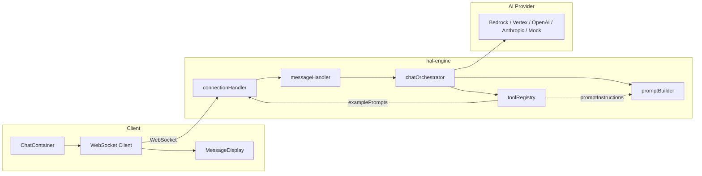
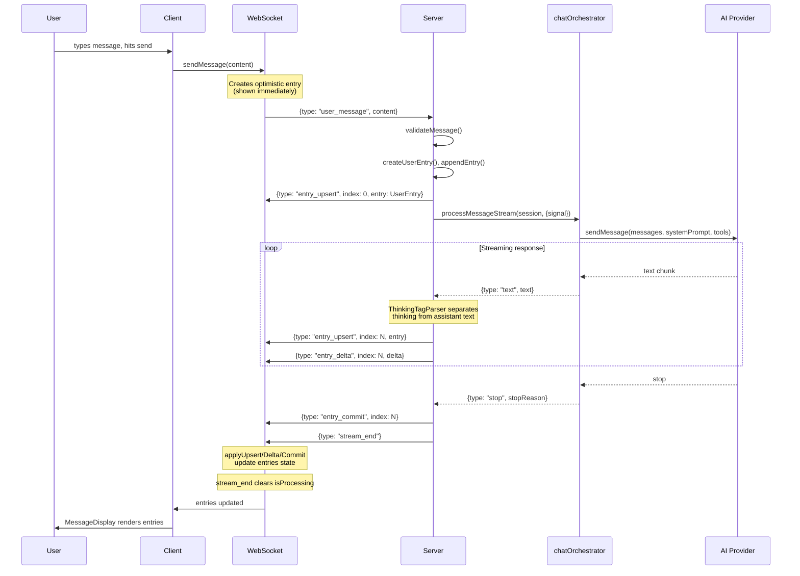
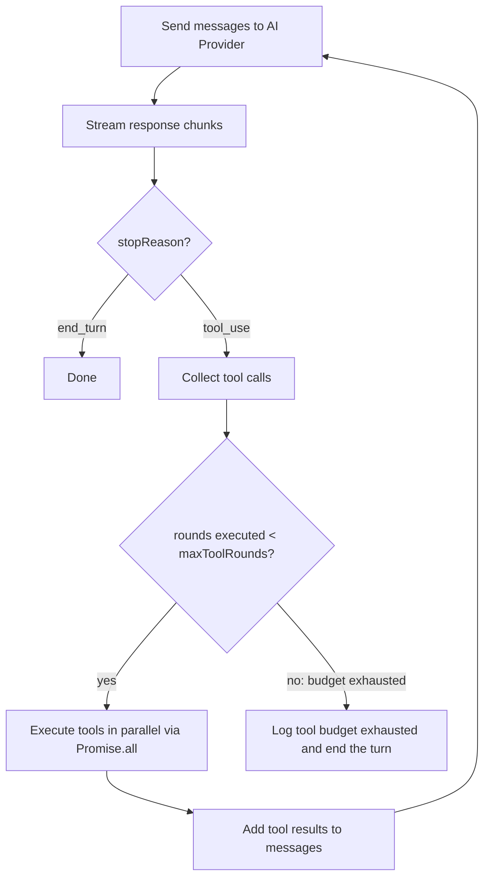

# Architecture

| Field  | Value       |
| ------ | ----------- |
| Issue  | n/a         |
| Status | In Progress |

This document walks through how the hal-engine system works, from the moment a user types a message to the moment they see a streaming response.

## The Big Picture

The system has three layers: a frontend client, a Node.js backend (hal-engine), and a pluggable AI provider. They communicate over WebSocket for real-time streaming.

Only the middle layer is this repository. The `Client` group below, the `applyUpsert`/`applyDelta`/`applyCommit` functions in Entry Streaming Protocol, the reconnection and unmount behaviour under Connection Lifecycle, and the spinner logic in Tool Execution Loop all describe a browser client. They are here because the protocol only makes sense as a pair, not because any of it ships from here.



## Source Layering

### Background

`src/` is five mandatory layers plus two cross-cutting folders, and the direction of import between them is the architecture rather than a convention. `layers.yaml` declares it as data and `re-lint/no-cross-layer-import` enforces it, so a shortcut fails lint rather than review. The documented order — types → providers → infrastructure → orchestration → transport — reads as a chain; the real graph is the DAG below.

### The declared graph

- `providers` is a sibling of `infrastructure`, not a link in the chain: neither may import the other, and both may reach `types` and `shared` and nothing further ([validated by: reports a sibling import both ways, because providers and infrastructure are not a chain](../../scripts/eslint-layers.test.ts#L62)).
- `orchestration` may not import `providers`: it depends on the `AIProvider` interface in `types` and never on a concrete provider, which is the property that lets a provider be swapped by configuration alone ([validated by: reports orchestration importing a concrete provider, the coupling the architecture forbids](../../scripts/eslint-layers.test.ts#L39)).
- `types` is the bottom layer and may import nothing, so every import out of it is upward and is reported ([validated by: reports an upward import from the bottom layer, which may import nothing](../../scripts/eslint-layers.test.ts#L47)).
- An import the layering does declare passes untouched, and movement inside a layer is free ([validated by: allows a downward import the layering declares](../../scripts/eslint-layers.test.ts#L53)).
- The gate governs files under `src/`, and that scope is checked rather than assumed: a matcher which silently matches nothing fails the suite ([validated by: governs files under src, so a matcher that silently matches nothing fails here](../../scripts/eslint-layers.test.ts#L111)).
- `shared` is cross-cutting: every layer above `types` may reach the logger it holds, and `types` is not among them — it may import nothing at all, the logger included ([validated by: lets every layer above types reach shared, but not types itself](../../scripts/eslint-layers.test.ts#L84)).
- `shared` itself imports nothing, which keeps it a leaf rather than a second composition root ([validated by: reports shared importing anything at all, so the cross-cutting layer stays a leaf](../../scripts/eslint-layers.test.ts#L78)).
- `.` — `src/config.ts` and `src/index.ts` — is the composition root, the one place allowed to see every layer, because assembling them is its job ([validated by: lets the composition root at src/ see every layer, because assembling them is its job](../../scripts/eslint-layers.test.ts#L94)).
- A folder with no entry in `layers.yaml` may import nothing, which is what keeps that file honest as `src/` grows ([validated by: gives a folder with no layers.yaml entry no imports at all](../../scripts/eslint-layers.test.ts#L103)).

### Rationale

This gate's failure mode is silence rather than a false report, which is why the suite pins that it still reports at all. The rule keys packages by `<package>/src/`, a shape that suits a monorepo of packages and not a single package whose code sits at `./src`. Left to locate `layers.yaml` on its own it resolves every file as `src/...`, matches no package and reports nothing — adopted in appearance, enforcing nothing. `eslint.config.mjs` re-homes the entries under this checkout's own directory name, with the root moved one level up, to give the matcher the shape it expects.

## Pluggable Interfaces

### Background

hal-engine is designed around pluggable interfaces that let consumers customize behavior without modifying internals.

### SessionStore

Controls where session data is stored: the default `InMemorySessionStore` keeps sessions in a `Map` ([validated by: creates and retrieves a session](../../src/infrastructure/stores/inMemorySessionStore.test.ts#L13)). Implement this interface to persist sessions in Redis, a database, or any other backing store. The store is generic -- pass your own session type extending `BaseSession`.

<!-- doc-block: src/types/sessionStore.ts#SessionStore -->
```typescript
interface SessionStore<T extends BaseSession = ChatSession> {
  create(sessionId: string, userId: string | number, options?: SessionCreateOptions): Awaitable<T>;
  get(sessionId: string): Awaitable<T | undefined>;
  delete(sessionId: string): Awaitable<boolean>;
  count(): Awaitable<number>;
  clear(): Awaitable<void>;
  /** Drops a session the client never received, without erasing anything a consumer would want kept. */
  evict?(sessionId: string): Awaitable<boolean>;
  /** Write signal: fires once per processed user message; failures are swallowed (specs/hal-engine-session-write-signal/spec.md). */
  save?(session: T): Awaitable<void>;
  /** Summaries of the user's conversations, newest activity first, so a client can offer a list of them (specs/hal-engine-conversation-list/spec.md). */
  listFor?(userId: string | number, options?: SessionListOptions): Awaitable<SessionSummary[]>;
  /** The user's most recently active session the store still holds, so a connect that names none can continue it (specs/hal-engine-session-resume/spec.md). */
  latestFor?(userId: string | number): Awaitable<T | undefined>;
  /** Tells an expired session from a missing one; `missing` is always a permitted answer, and a store without it behaves as `get` (specs/hal-engine-session-resume/spec.md). */
  lookup?(sessionId: string): Awaitable<SessionLookup<T>>;
}
```

- `create` records the optional `authHeaders` and `workspaceId` on the session it returns, so a tool can later reach upstream services as the caller ([validated by: creates session with options](../../src/infrastructure/stores/inMemorySessionStore.test.ts#L29)).
- `ChatSession.createdAt` is written by the store, not the engine: `InMemorySessionStore.create` stamps it, ISO 8601, at the time of the call ([validated by: stamps createdAt at create as the ISO 8601 time of the call, 2026-10-20T08:00:00.000Z on a clock set to it](../../src/infrastructure/stores/inMemorySessionStore.test.ts#L78)).
- `MongoSessionStore` sets `createdAt` from the creation time it writes to the document, on the session `create` returns and on one a second store reads back ([validated by: sets createdAt to the document's creation time, 2026-10-20T08:00:00.000Z, on create and on a second store's read](../../src/infrastructure/stores/mongo/mongoCreatedAt.test.ts#L10)).
- A document that holds no creation time reads back with no `createdAt` key ([validated by: reads a document that holds no createdAt back as a session with no createdAt key](../../src/infrastructure/stores/mongo/mongoCreatedAt.test.ts#L23)).
- The field is optional, so a session stored before it existed completes a turn unchanged ([validated by: completes a turn unchanged on a session with no createdAt, as one stored before the field existed would be](../../src/orchestration/entryFactories.test.ts#L23)).
- A consumer may type its own sessions with `createdAt` required and implement `SessionStore` over them ([validated by: lets a consumer type its sessions with createdAt required and implement SessionStore over them](../../src/infrastructure/stores/inMemorySessionStore.test.ts#L87)).
- `assertScalarUserId`, exported for a consumer's own store, refuses a user id that is not a string or a finite number, naming its kind rather than its contents ([validated by: is refused by assertScalarUserId for an operator object, undefined, null, an array, NaN and Infinity](../../src/infrastructure/stores/scalarUserId.test.ts#L10)).
- `InMemorySessionStore` refuses such an id in `create`, `listFor` and `latestFor` ([validated by: is refused by InMemorySessionStore create, listFor and latestFor, which hold nothing afterwards](../../src/infrastructure/stores/scalarUserId.test.ts#L33)).
- `MongoSessionStore` refuses it in the same three methods before any query reaches the collection, so a caller of its own, a maintenance script or an HTTP route, gets the same refusal as the WebSocket path ([validated by: is refused by MongoSessionStore create, listFor and latestFor before any query reaches the collection](../../src/infrastructure/stores/scalarUserId.test.ts#L53)).
- `get` returns `undefined` for a session id the store does not hold, rather than throwing ([validated by: returns undefined for unknown session](../../src/infrastructure/stores/inMemorySessionStore.test.ts#L41)).
- `delete` removes the session and reports `true` ([validated by: deletes a session](../../src/infrastructure/stores/inMemorySessionStore.test.ts#L45)).
- `delete` reports `false` for an id the store was not holding ([validated by: returns false when deleting nonexistent session](../../src/infrastructure/stores/inMemorySessionStore.test.ts#L52)).
- `count` reflects creates and deletes as they happen ([validated by: tracks count correctly](../../src/infrastructure/stores/inMemorySessionStore.test.ts#L56)).
- `clear` empties the store, leaving `count` at zero and every previous id unresolvable ([validated by: clears all sessions](../../src/infrastructure/stores/inMemorySessionStore.test.ts#L70)).
- `save` is the optional write signal the engine calls once per processed user message, detailed in [the session write signal spec](../hal-engine-session-write-signal/spec.md); a store that omits it, as `InMemorySessionStore` does, is unaffected ([validated by: logs nothing for a store that implements no save](../../src/orchestration/sessionSave.test.ts#L67)).

### WsAuthenticator

Authenticates WebSocket connections during the handshake. It receives the whole Node `IncomingMessage`, not a pre-extracted token, so it can read credentials from wherever the client put them. Return the authenticated user to accept the connection, or `null` to reject it with HTTP 401 -- a rejection is a returned `null`, not a thrown error.

<!-- doc-block: src/types/auth.ts#WsAuthenticator -->
```typescript
type WsAuthenticator = (req: IncomingMessage) => Promise<AuthenticatedUser | null>;
```

<!-- doc-block: src/types/session.ts#AuthenticatedUser -->
```typescript
interface AuthenticatedUser {
  id: string | number;
  [key: string]: unknown;
}
```

The connection handler takes `id` as the session's `userId` and picks up `workspaceId` when the returned user carries one. The request it receives has already been checked for a credential conflict: an upgrade whose `Authorization` header and subprotocol carry different credentials is refused with `400` before this function runs, so whichever carrier it reads, the credential it validates is the one the engine forwards in the session's `authHeaders.authorization`, the header or the first `Sec-WebSocket-Protocol` value that is not the `hal.v1` marker as `Bearer <token>`, for a tool to proxy the caller's credentials upstream ([validated by: refuses Bearer attacker-token beside a victim-token subprotocol with 400 before wsAuth runs, and neither value reaches the response or a log line](../../src/transport/handshake.test.ts#L180)). The client offers two values, `hal.v1, <access-token>`, and the server answers only `hal.v1`.

#### What reaches a tool as `context.user`

- Over a WebSocket connection, everything `auth.ws` returned, not only `id` and `workspaceId`, reaches a tool as `context.user`, beside an unchanged `context.userId` and `context.workspaceId`. The engine reads no field of it beyond those two, so authorization on any other claim stays in consumer code ([validated by: hands whoami context.user deep-equal to what auth.ws returned, beside userId u1 and workspaceId w1, over a real connection](../../src/transport/toolContextUser.test.ts#L71)).
- `session.user.id` and `session.userId` are set from the same returned `id`, so they agree on every session the connection handler creates ([validated by: sets session.user.id to u1, the same id as session.userId, on a session the connection handler created](../../src/transport/toolContextUser.test.ts#L85)).
- `context.user` is a shallow copy made for each call, so an executor that assigns to it changes neither the session's user nor the copy a sibling call in the same round reads; nested values stay shared, which is why a tool treats it as read-only ([validated by: keeps session.user.id u1 and hands the round's next tool u1 when the first assigns context.user.id = 'attacker'](../../src/orchestration/toolContextUser.test.ts#L24)).
- A session created with no `user` hands a tool `context.user` undefined, and `context.userId` still identifies the caller ([validated by: hands context.user undefined to a tool on a session created with no user, and its context.userId is still u1](../../src/orchestration/toolContextUser.test.ts#L44)).
- The REST chat routes have no `AuthenticatedUser` to draw from, so a tool reached through them gets `context.user` undefined while `context.userId` carries the chat's user id ([validated by: receives context.user undefined and context.userId alice, the chat's user id, though the middleware attached more claims](../../src/transport/routes/chatsToolContext.test.ts#L9)).
- `ChatSession.user` is connection-scoped, like `authHeaders`: the newest open socket lends it, a resume takes it from the fresh upgrade rather than restoring it, and once no socket is left it is cleared ([validated by: takes session.user from the upgrade that resumed the session, role second, and gives back role first when that socket closes](../../src/transport/toolContextUser.test.ts#L113)).
- No store persists it: `MongoSessionStore` writes no `user` key and a session read back carries none, while the session `create` returned holds it in memory ([validated by: writes no user key to the stored document and reads back a session with none, though create and save were handed one](../../src/infrastructure/stores/mongo/mongoRedaction.test.ts#L66)).
- Under GDPR, `user` is a processing step: the claims resolved at connect reach every tool call for the connection's life, are held in memory only, and are written to no log line at any level and to no frame ([validated by: writes the secret-shaped claim to no log line at any level and to no frame, though the tool received it](../../src/transport/toolContextUser.test.ts#L97)).

### AIProvider

The core abstraction for AI model communication. Each provider (Bedrock, Vertex, OpenAI, Anthropic) implements this interface. The orchestrator depends only on this interface, never on provider-specific code.

<!-- doc-block: src/types/ai.ts#AIProvider -->
```typescript
interface AIProvider {
  sendMessage(params: SendMessageParams): AsyncGenerator<MessageChunk>;
  generateStructured<T>(params: StructuredOutputParams<T>): Promise<T>;
}
```

- `sendMessage` streams responses for user-facing output ([validated by: streams word-by-word response echoing user input](../../src/providers/mock/mockProvider.test.ts#L8)).
- `generateStructured` returns typed JSON for internal AI decisions, such as evaluation, classification and structured extraction ([validated by: returns default values matching schema shape](../../src/providers/mock/mockProvider.test.ts#L73)).

### PromptStore

Loads prompt templates by name with variable substitution ([validated by: returns prompt template when found](../../src/infrastructure/stores/inMemoryPromptStore.test.ts#L11), [resolve](../../src/infrastructure/stores/inMemoryPromptStore.test.ts#L28)). Use this for database-driven prompts instead of static `PromptBuilder` configuration.

<!-- doc-block: src/types/promptStore.ts#PromptStore -->
```typescript
interface PromptStore {
  findByName(name: string): Promise<PromptTemplate | undefined>;
  resolve(name: string, variables?: Record<string, string>): Promise<string>;
}
```

- `findByName` returns `undefined` for a name the store does not hold ([validated by: returns undefined when not found](../../src/infrastructure/stores/inMemoryPromptStore.test.ts#L17)).
- `resolve` returns a template with no placeholders unchanged ([validated by: returns template without substitution when no variables](../../src/infrastructure/stores/inMemoryPromptStore.test.ts#L23)).
- `resolve` substitutes every variable it is given ([validated by: substitutes multiple variables](../../src/infrastructure/stores/inMemoryPromptStore.test.ts#L33)).
- A placeholder appearing more than once is substituted at every occurrence, not only the first ([validated by: substitutes all occurrences of same variable](../../src/infrastructure/stores/inMemoryPromptStore.test.ts#L42)).
- A placeholder with no matching variable is left in the output verbatim, so a missing value shows up as `{role}` rather than as a blank the reader cannot spot ([validated by: leaves unmatched placeholders intact](../../src/infrastructure/stores/inMemoryPromptStore.test.ts#L47)).
- `resolve` rejects when the prompt name is unknown, because a caller asking for a template by name has no sensible fallback ([validated by: throws when prompt not found](../../src/infrastructure/stores/inMemoryPromptStore.test.ts#L52)).

### UsageStore

Tracks AI call metadata such as token counts and model version, for cost monitoring ([validated by: records and retrieves usage by session](../../src/infrastructure/stores/inMemoryUsageStore.test.ts#L24)).

<!-- doc-block: src/types/usageStore.ts#UsageStore -->
```typescript
interface UsageStore {
  record(entry: UsageRecord): Promise<void>;
  getBySession(sessionId: string): Promise<UsageRecord[]>;
}
```

- `getBySession` returns an empty array for a session with no records, never `undefined`, so a caller can total the results without a null check ([validated by: returns empty array for unknown session](../../src/infrastructure/stores/inMemoryUsageStore.test.ts#L31)).
- `getBySession` returns only the records of the session asked for, in the order they were recorded ([validated by: filters by session ID](../../src/infrastructure/stores/inMemoryUsageStore.test.ts#L35)).

### PromptBuilderConfig

Configures static system prompt assembly. Provide your AI identity, domain context, response guidelines, and custom instructions. The `PromptBuilder` combines these with tool instructions from the registry into the final system prompt.

<!-- doc-block: src/infrastructure/builders/promptBuilder.ts#PromptBuilderConfig -->
```typescript
interface PromptBuilderConfig {
  identity: string;
  domainContext?: string;
  responseGuidelines?: string;
  toolPreamble?: string;
}
```

`toolPreamble` overrides the built-in instructions that tell the model when to reach for a tool; leave it unset to keep the default.

### OrchestratorHooks

Async lifecycle hooks for customizing the orchestration flow. Every hook is optional and receives the current session, and an orchestrator built with none behaves exactly as one built with an empty set ([validated by: works without any hooks configured](../../src/orchestration/chatOrchestrator.test.ts#L447)). Install hooks through `HalEngineConfig.orchestrator.hooks`; `createHalEngine` forwards the set to the orchestrator ([validated by: forwards an orchestrator hook, so one passed through the config actually fires](../../src/config.test.ts#L26)).

<!-- doc-block: src/orchestration/chatOrchestrator.ts#OrchestratorHooks -->
```typescript
interface OrchestratorHooks {
  beforeSession?: (session: ChatSession) => Promise<void>;
  afterSession?: (session: ChatSession) => Promise<void>;
  beforeUserInput?: (session: ChatSession, userMessage: string) => Promise<string>;
  afterUserInput?: (session: ChatSession, userMessage: string) => Promise<void>;
  beforeModelResponse?: (session: ChatSession, systemPrompt: string) => Promise<string>;
  afterModelResponse?: (session: ChatSession, responseText: string, totalUsage?: UsageMetadata) => Promise<void>;
  onError?: (session: ChatSession, error: Error) => Promise<void>;
  /** The supported seam for an EU AI Act Art. 14 human-oversight control: fires before each known tool's executor, and a returned ToolResponse replaces the call (see docs/adding-a-tool.md); it receives the model's raw tool input and, through session, the caller's authHeaders, so a policy that logs either logs personal data and credential material; the engine asserts nothing about any policy installed here. */
  beforeToolCall?: (session: ChatSession, call: ToolCall) => Promise<ToolResponse | undefined>;
  /** Fires when the model asks for a tool round the budget refuses, after the last provider call and before afterModelResponse; a returned string reaches the user as the turn's closing text, and the engine writes none of its own (see specs/hal-engine-tool-budget/spec.md). */
  onToolBudgetExhausted?: (session: ChatSession, budget: ToolBudgetInfo) => Promise<string | undefined>;
}
```

The hooks fire in this order:

```
beforeSession → beforeUserInput → afterUserInput → beforeModelResponse → ...streaming (beforeToolCall × each tool call, each round)... → onToolBudgetExhausted (only on an exhausted budget) → afterModelResponse → afterSession
```

- The order above holds for a successful pass ([validated by: calls all hooks in correct order](../../src/orchestration/chatOrchestrator.test.ts#L374)).
- When the stream fails, `afterModelResponse` is skipped and the tail becomes `onError` then `afterSession` ([validated by: error path calls onError then afterSession](../../src/orchestration/chatOrchestrator.test.ts#L414)).
- `beforeSession` runs before any other hook ([validated by: called before anything else](../../src/orchestration/chatOrchestrator.test.ts#L131)).
- `beforeUserInput` receives the content of the last user message ([validated by: receives the last user message content](../../src/orchestration/chatOrchestrator.test.ts#L199)).
- `beforeUserInput` can modify that message by returning a different string ([validated by: modifies user message when returning different value](../../src/orchestration/chatOrchestrator.test.ts#L214)).
- `afterUserInput` receives the message as `beforeUserInput` left it, not as the client sent it ([validated by: receives user message after any beforeUserInput modification](../../src/orchestration/chatOrchestrator.test.ts#L229)).
- `beforeModelResponse` can replace the system prompt, for example loading it from a `PromptStore` ([validated by: replaces system prompt with returned value](../../src/orchestration/chatOrchestrator.test.ts#L246)).
- `beforeModelResponse` can also set `session.activePersona`, and every assistant entry created for that turn carries it, since the hook runs before the first one exists ([validated by: stamps 'p-two' when beforeModelResponse changes the session's activePersona from 'p-one' mid-turn](../../src/transport/ws/assistantPersona.test.ts#L98)).
- `afterModelResponse` receives the collected response text and the usage the provider reported ([validated by: receives collected response text and usage](../../src/orchestration/chatOrchestrator.test.ts#L261)).
- `afterModelResponse` does not run when the stream throws, so it never reports a response that was not delivered ([validated by: not called when stream throws](../../src/orchestration/chatOrchestrator.test.ts#L281)).
- `onError` receives the session and the error ([validated by: called with session and error when stream fails](../../src/orchestration/chatOrchestrator.test.ts#L303)).
- `onError` observes rather than handles: the error still propagates to the caller after it returns ([validated by: error still propagates after onError hook](../../src/orchestration/chatOrchestrator.test.ts#L325)).
- `onToolBudgetExhausted` fires only when the model asks for a tool round the budget refuses: after the last provider call and before `afterModelResponse`, which then receives the hook's sentence at the end of the response text ([validated by: hands afterModelResponse text ending in the sentence, and the usage of a run without the hook](../../src/orchestration/toolBudget.test.ts#L214)).
- `afterSession` runs after everything else completes ([validated by: called after everything completes](../../src/orchestration/chatOrchestrator.test.ts#L170)).
- `afterSession` fires even on error ([validated by: called even when an error occurs](../../src/orchestration/chatOrchestrator.test.ts#L180)).

A hook receives the full `session` object, so it has access to `session.authHeaders?.authorization` (the caller's bearer token, when `auth.forwardHeaders` lets it through, as [the tool header allowlist spec](../hal-engine-tool-header-allowlist/spec.md) describes) and every user message verbatim through `session.entries`; the engine redacts nothing before calling a hook. Anything a hook persists becomes the deployer's own data-retention obligation.

## Message Lifecycle

Here is what happens from the moment a user hits "send" to the moment they see a response streaming in:



### One message at a time

The transport queues each `user_message` run on a `PerSessionLock` (`src/shared/perSessionLock.ts`) keyed by the session id, not the socket, since a resumed session can be open on more than one (re-cinq/HALEngine#47). What that means on the wire is in [the protocol spec, § 4.1](../hal-engine-websocket-protocol/spec.md#41-user_message).

- The lock runs two callbacks on one key in call order: the second starts only once the first has settled ([validated by: runs two callbacks on one key in call order, the second only once the first has settled](../../src/shared/perSessionLock.test.ts#L16)).
- Callbacks on different keys never wait for each other ([validated by: starts callbacks on different keys without either waiting for the other](../../src/shared/perSessionLock.test.ts#L34)).
- A callback that throws hands its rejection to its own caller, and the next callback on that key still runs ([validated by: hands a rejection to its own caller and still runs the next callback on that key](../../src/shared/perSessionLock.test.ts#L53)).
- The lock holds a key only while a callback on it is queued or running, and nothing but keys and promises, so an idle server keeps no session id and no message content ([validated by: holds no key once every queued callback has settled](../../src/shared/perSessionLock.test.ts#L68)).

## Entry Streaming Protocol

Every piece of content in the conversation is a **SessionEntry**. The protocol has two halves that mirror each other: the server mutates its session array and sends a frame describing the change, and the client applies that frame to its own copy.

### On the server

`src/orchestration/entryMutations.ts` holds three functions, and all three mutate `session.entries` in place.

| Function      | Signature                         | Effect                                              |
| ------------- | --------------------------------- | --------------------------------------------------- |
| `appendEntry` | `(session, entry) => number`      | Pushes the entry and returns the index it landed at |
| `appendDelta` | `(session, index, delta) => void` | Concatenates onto `entry.content`                   |
| `commitEntry` | `(session, index) => void`        | Sets `isStreaming = false`                          |

`appendEntry` returns a number because its caller needs that index for the frame it sends next. The other two return nothing, because the mutation is the result.

`appendDelta` and `commitEntry` act only on `assistant` and `thinking` entries. Called against a `user` or `tool` entry they do nothing and report nothing -- neither role carries streaming content, so there is no failure to report.

### On the wire

Four frame types, not three.

| Server message | Sent when                                        | Client function                       |
| -------------- | ------------------------------------------------ | ------------------------------------- |
| `entry_upsert` | an entry is created, or replaced at an index     | `applyUpsert()`                       |
| `entry_delta`  | text is appended to a streaming entry            | `applyDelta()`                        |
| `entry_commit` | an entry is finalised                            | `applyCommit()`                       |
| `entry_skip`   | an entry exists server-side but is not forwarded | none -- the client advances its index |

`entry_skip` is what a suppressed model response, thinking or assistant, produces. The entry stays in the session so the model's next turn sees it, and the client is told to move past that index without rendering anything. The WebSocket protocol spec covers the index arithmetic in its § 8.2.

The client's `applyUpsert`/`applyDelta`/`applyCommit` return new arrays and never mutate. The server's three do the opposite. That asymmetry is deliberate: the server owns one session object for the life of a connection, while the client re-renders from a fresh array.

## Tool Execution Loop

At the start of every turn, after the input hooks and before `beforeModelResponse`, the orchestrator reads the `ToolRegistry` once. That read gives it the definitions it sends the provider and the `promptInstructions` of each tool, which `PromptBuilder` assembles alongside the AI's identity, domain context, and response guidelines into the system prompt for that turn.

### What a turn reads from the registry

- A tool registered after the orchestrator was built is sent to the provider and named in the system prompt, under the default tool preamble, from the next turn, so a registry that starts empty may be filled after construction ([validated by: sends weather, registered after the orchestrator was built on an empty registry, as the only tool and names it under the default preamble](../../src/orchestration/toolsPerTurn.test.ts#L48)).
- A tool registered between two turns is absent from the first turn's request and present in the second's ([validated by: sends tools undefined on the first turn and weather alone on the second when weather is registered between them](../../src/orchestration/toolsPerTurn.test.ts#L65)).
- The read is per turn, not per round: a tool registered while a turn runs, by one of its executors say, reaches no later round of that turn, so the list the model sees does not change while an unanswered `tool_use` block from an earlier round is still in its messages ([validated by: keeps weather, registered by an executor mid-turn, out of round 2 of that turn and sends it from the next turn](../../src/orchestration/toolsPerTurn.test.ts#L77)).
- A registry with no tools sends the provider `tools: undefined`, never an empty array, because Bedrock and Vertex read an empty list differently; Bedrock's request then carries no `toolConfig` key ([validated by: calls sendMessage with tools undefined, and Bedrock builds a request with no toolConfig key](../../src/emptyToolList.test.ts#L28)).
- A definition registered as a thunk is read once at the start of each turn for what that turn advertises, so a definition it changes between turns reaches the provider changed ([validated by: invokes a definition thunk once in each of two turns that call no tool, so the second turn sends its changed description](../../src/orchestration/toolsPerTurn.test.ts#L99)).
- Each call the turn executes reads the thunk once more, to validate that call's input, so a turn calling the tool once invokes it twice ([validated by: invokes a definition thunk twice in a turn that calls its tool once: at the turn start, then for the call](../../src/orchestration/toolsPerTurn.test.ts#L124)).
- A hook sees the same read: `beforeModelResponse` receives a prompt naming a tool registered after `createHalEngine` returned ([validated by: hands beforeModelResponse a prompt naming weather, a tool registered after createHalEngine returned](../../src/config.test.ts#L166)).
- Every tool `description`, `inputSchema` and `promptInstructions` string is sent to the model provider every turn, not once per process, so under GDPR a definition carries no personal data and no internal hostname; the orchestrator logs a tool's name and never its definition ([validated by: writes no tool description, input schema or prompt instructions to the log over a turn that calls the tool](../../src/orchestration/toolsPerTurn.test.ts#L142)).

Because the advertised list is re-read every turn, leaving a tool unregistered or unadvertised is not an access control, which matters for the human oversight Article 14 of the EU AI Act asks for. A policy that must keep a capability from being used enforces it at execution, in `beforeToolCall` or in the executor itself. The registry stays process-wide: there is no per-session or per-user tool list, and no `unregister`.

When the AI model decides it needs data (like weather information or a database lookup), it requests a tool call. The orchestrator handles this in a loop:



Here is what the message handler does when a tool call comes through:

1. The model yields a `tool_use` chunk with tool name and input
2. The handler creates a `ToolEntry` and sends it to the client via `entry_upsert`
3. The orchestrator executes the tool (via `ToolRegistry.execute()`)
4. Tool results get added to the conversation as a `tool_result` message
5. If the tool returned `clientMessages`, they are forwarded to the frontend as-is, in one `tool_result` chunk ([validated by: forwards the client messages a tool returned as one tool_result chunk](../../src/orchestration/chatOrchestrator.test.ts#L524))
6. If the tool set `suppressAssistantResponse`, the AI's next reply is kept in session context but hidden from the frontend ([validated by: asks for suppression when the tool says the reply is already handled](../../src/orchestration/chatOrchestrator.test.ts#L554))
7. The orchestrator re-queries the AI provider with the updated messages, and the chunks of every round reach the client in order ([validated by: runs another round after a tool call and streams both rounds in order](../../src/orchestration/chatOrchestrator.test.ts#L489))
8. This repeats until the budget is spent: at most `maxToolRounds` tool rounds are executed, and the provider is called at most `maxToolRounds + 1` times, so the default of 5 executes five rounds and makes six model calls, the last of which reads the fifth round's results. A round requested after that is not executed; see [the tool budget spec](../hal-engine-tool-budget/spec.md) ([validated by: executes 5 tool rounds and makes 6 provider calls at the default budget](../../src/orchestration/toolBudget.test.ts#L95), [validated by: stops asking for tools once maxToolRounds is spent](../../src/orchestration/chatOrchestrator.test.ts#L510))

### Whether a round continues

- A round continues only when the model stopped for `tool_use`, named at least one tool, and a `ToolRegistry` is configured ([validated by: continues when the model requested a tool and a registry can run it](../../src/orchestration/orchestratorHelpers.test.ts#L11)).
- With no registry configured the loop stops, whatever the model asked for, because nothing could execute the call ([validated by: stops when no registry is configured, whatever the model asked for](../../src/orchestration/orchestratorHelpers.test.ts#L15)).
- A `tool_use` stop naming no tool stops the loop, rather than re-querying with nothing to add ([validated by: stops when the model named no tool](../../src/orchestration/orchestratorHelpers.test.ts#L19)).
- Any other stop reason ends the loop even when tool calls are pending ([validated by: stops when the model finished for a reason other than tool use](../../src/orchestration/orchestratorHelpers.test.ts#L23)).

### Across rounds

- A tool call's `signature`, an opaque token its provider needs back, is copied onto its `tool_use` block for the next round, and a call without one gets no `signature` key ([validated by: puts sig-1 on the signed call's tool_use block and no signature key on the unsigned one](../../src/orchestration/orchestratorHelpers.test.ts#L29)).
- A call to a tool name the model invented is answered rather than raised, with a result naming it and the registered tools, and the turn goes on ([validated by: answers a call to a tool name the model invented, and the turn goes on to its answer](../../src/orchestration/chatOrchestrator.test.ts#L757)).
- So is a call whose executor throws: it gets a result saying the call failed, its message reaches only the log, as [tool-executor-throw](../hal-engine-tool-executor-throw/spec.md) specifies, and the turn goes on ([validated by: answers a call whose executor threw, and the turn goes on to its answer with afterModelResponse and no onError](../../src/orchestration/chatOrchestrator.test.ts#L770)).
- A tool signals a failed call by returning `isError: true` beside its `result`, and the engine marks the failures it substitutes the same way, so the provider is told the call failed instead of leaving the model to infer it from prose; [the tool responses spec](../hal-engine-tool-responses/spec.md) gives each provider's encoding ([validated by: carries isError true from an executor's {result: 'lookup failed', isError: true} onto the tool_result the provider's next call gets](../../src/orchestration/toolResultError.test.ts#L62)).
- The loop ends as soon as a round stops with `end_turn`, and nothing further is asked of the provider ([validated by: stops after one round when nothing asked for a tool](../../src/orchestration/chatOrchestrator.test.ts#L501)).
- An `entry_upsert` a tool returns is appended to the session and its index rewritten to the position it actually landed in, because a tool cannot know how long the session already is ([validated by: appends an upserted entry to the session and rewrites its index to match](../../src/orchestration/chatOrchestrator.test.ts#L537)).
- The response text a hook sees is the text of every round joined, not only the last ([validated by: joins the text of every round, not only the last](../../src/orchestration/chatOrchestrator.test.ts#L566)).
- Usage an earlier round reported is kept when a later round reports none, so a tool round does not erase the token count ([validated by: keeps the usage an earlier round reported when a later round reports none](../../src/orchestration/chatOrchestrator.test.ts#L598)).
- The usage `afterModelResponse` receives is `totalUsage`: the sum of what every provider call in the turn reported, so a turn that ran tools counts every round rather than the last one alone ([validated by: sums the usage of every round, not only the last](../../src/orchestration/chatOrchestrator.test.ts#L616)).
- A round that reports no usage drops out of the sum rather than voiding it: the rounds that did report are still counted, and a turn where nothing reported reports nothing ([validated by: counts every reporting round even when a round between them reports none](../../src/orchestration/chatOrchestrator.test.ts#L638)).

The frontend shows a spinner on the last tool entry while the stream is still processing (`isProcessing` is `true`). The `stream_end` message clears the processing state, which hides the spinner. This works correctly even when tool suppression prevents assistant entries from reaching the frontend. See [tool-responses.md](../hal-engine-tool-responses/spec.md) for details on client messages and suppression.

## Thinking Tag Parsing

The AI model can wrap internal reasoning in `<thinking>...</thinking>` tags. The `ThinkingTagParser` separates these from user-facing text during streaming.

```
Input stream: "Let me check<thinking>I should use the weather tool</thinking>The forecast is..."

Parsed segments:
  {type: 'text',     content: 'Let me check'}
  {type: 'thinking', content: 'I should use the weather tool'}
  {type: 'text',     content: 'The forecast is...'}
```

The parser is stateful and handles partial tags at chunk boundaries. For example, if a chunk ends with `</thin`, the parser buffers it until the next chunk completes the tag. Its full contract is in `specs/hal-engine-thinking-tag-parser/spec.md`.

The message handler routes these segments to different entries:

- `thinking` segments go into a `ThinkingEntry` (collapsible in the UI)
- `text` segments go into an `AssistantEntry` (rendered as markdown), stamped with the session's `activePersona` as its `persona` when one is set ([validated by: sends the assistant entry_upsert with persona 'support' when the session's activePersona is support](../../src/transport/ws/assistantPersona.test.ts#L84)).

When a thinking block closes, the handler commits the `ThinkingEntry` before starting (or continuing) the `AssistantEntry`.

## Connection Lifecycle

### Establishing a connection

1. The client calls `POST {basePath}/chats` to create a chat, getting back a `chatId`
2. The client builds a WebSocket URL: `wss://{host}{basePath}/ws`, adding `?sessionId={sessionId}` on a reconnect that wants its conversation back. The server checks only the `{basePath}/ws` prefix; the query parameter is not a credential, and with `transport.resume` enabled it is honoured only for the connection's own authenticated user (step 5)
3. The client offers two WebSocket subprotocols, `hal.v1, <access-token>` (no query string exposure), and the server answers only the `hal.v1` marker, so the token never appears in the response
4. The server's `handleUpgrade` passes the upgrade request to the configured `WsAuthenticator`, which returns a user or `null`, before completing the handshake; what it reads from that request - a header, a cookie, a subprotocol - is the consumer's business, not this package's
5. On connection, the server creates a `ChatSession` and sends a `connected` message, including the `examplePrompts` the tool registry holds at that connection, since they are collected per connection and not once at startup. With resume enabled, a requested id whose stored session belongs to the connecting user is rejoined instead: the frame carries `resumed: true` and `entryCount`, and the stored entries are replayed; any other id gets a fresh, server-minted session and `resumed: false`

- A socket opened before a tool is registered is offered none of its example prompts, and one opened after is offered them ([validated by: offers no prompts to a socket opened before weather is registered and its prompt to one opened after](../../src/transport/connectExamplePrompts.test.ts#L9)).

### Heartbeat

- The server sends a WebSocket `ping` frame at the configured `heartbeatIntervalMs` interval (default 30 seconds)
- If a client doesn't respond with `pong`, the connection is terminated
- The client can also send application-level `ping` messages
- The server responds with `pong` messages (used for UI health indicators)

### Reconnection

When a connection drops, the frontend reconnects automatically:

- Exponential backoff: `1000ms * 2^retryCount` + random jitter (0-1000ms)
- Maximum delay: 31 seconds, per the formula in the websocket-protocol spec, Section 11.3
- Maximum retries: 5
- On reconnection, any queued messages are flushed immediately
- Entries are cleared on disconnect (the server will re-send them on the new session)

### Cleanup

- On unmount, the client closes the socket and clears all timers
- On disconnect, the server keeps the session and fires `onDisconnect`; it erases nothing, and the default store bounds its own memory by age instead
- On `SIGTERM`, nothing happens: no signal handler is installed. `createServer` exposes `stop()`, which closes every socket with code 1001 and clears the heartbeat, but the engine never calls it (websocket-protocol spec, Section 11.2)

## App Extension Points

### App extension points

`createApp` exposes two callbacks that let a consumer mount routes alongside the engine's own routes without hand-building an Express application.

- `HalAppOptions.rootRoutes?: (router: Router) => void` — a callback invoked with a fresh `Router` and mounted at the root of the app, after the `basePath` router and before the catch-all `404`, so a handler registered there can serve `GET /` while `GET {basePath}/health` still answers. ([validated by: mounts a rootRoutes handler at / before the catch-all 404](../../src/transport/createApp.test.ts#L128))
- A `rootRoutes` route at a path that also appears under the `basePath` prefix answers independently: `GET /health` goes to the root handler and `GET {basePath}/health` goes to the engine's health route. ([validated by: lets rootRoutes at /health and the basePath health answer independently](../../src/transport/createApp.test.ts#L149))
- `HalEngineConfig.transport.additionalRoutes` is forwarded to `createApp`, so a route registered there mounts under `basePath` in the server the engine builds, and not at the root. ([validated by: forwards transport.additionalRoutes to createApp so the route mounts under basePath](../../src/config.test.ts#L243))
- Neither `additionalRoutes` nor `rootRoutes` is covered by `auth.http`; both receive requests before any authentication middleware the engine installs, so a consumer applies its own middleware inside the callback. ([validated by: leaves additionalRoutes and rootRoutes open while auth.http still guards the chat routes](../../src/config.test.ts#L262))
- Both callbacks inherit the CORS, JSON body-parsing, and cookie-parsing middleware that `createApp` mounts unconditionally. ([validated by: gives additionalRoutes and rootRoutes the parsed JSON body, the cookies and the CORS headers](../../src/config.test.ts#L287))
- A `transport.errorHandler` receives what a route throws, whether synchronously or as a rejected promise, and the response it writes is the one the client gets, instead of Express's default HTML page. ([validated by: hands transport.errorHandler a route's synchronous throw and its rejected promise, and answers with its response](../../src/config.test.ts#L310))
- `engine.app` cannot be extended after `createHalEngine` returns: `createApp` registers a terminal `404` catch-all before returning, and Express matches routes in registration order, so a route added afterwards always returns `404`. ([validated by: answers 404 for a route added to engine.app after createHalEngine returns](../../src/config.test.ts#L331))

**The default error handler.** `createApp` always registers one last, after any `errorHandler` a consumer supplies, so nothing a route throws reaches Express's HTML page, and no response body carries an error's message or stack ([validated by: answers a truncated JSON body to POST /hal/chats with 400 {"error":"Bad Request"} as JSON, with no HTML or stack](../../src/transport/httpErrorHandler.test.ts#L48), [validated by: answers a synchronous throw and a rejected promise of boom-secret-42 with 500 {"error":"Internal Server Error"}, keeping the message out of the response](../../src/transport/httpErrorHandler.test.ts#L62)). It answers by the first row that applies:

| The error                                                            | Status      | Body `error`                                      |
| -------------------------------------------------------------------- | ----------- | ------------------------------------------------- |
| carries `status` or `statusCode` in 400–599 with a standard phrase   | that status | Node's phrase from `http.STATUS_CODES`, e.g. `Not Found` |
| an `AIError` coded `RATE_LIMITED`                                    | 429         | `AI service is busy, please try again`            |
| an `AIError` coded `SERVICE_UNAVAILABLE`                             | 503         | `AI service temporarily unavailable`              |
| an `AIError` coded `TIMEOUT`                                         | 504         | `AI service timed out`                            |
| an `AIError` with any other code                                     | 502         | `AI service temporarily unavailable`              |
| anything else                                                        | 500         | `Internal Server Error`                           |

- The four `AIError` rows are read from `src/transport/errorMapping.ts`, the one table the WebSocket error frame also reads, so a status here and a `code` there never disagree ([validated by: is the only non-test file under src/transport that maps a provider error code, rateLimit.ts aside](../../src/transport/errorMapping.test.ts#L67)).
- An explicit status wins over the `AIError` code, and one outside 400–599 or without a standard phrase, such as 302, 700 or 499, answers 500 ([validated by: honours status 404 and statusCode 403 with their standard phrases, and answers status 302, 700 and 499 with 500](../../src/transport/httpErrorHandler.test.ts#L100), [validated by: answers AIError codes RATE_LIMITED 429, SERVICE_UNAVAILABLE 503, TIMEOUT 504 and every other code 502, each with its fixed sentence](../../src/transport/httpErrorHandler.test.ts#L76)).
- The demo chat routes keep no mapping of their own: an orchestrator failure on `POST {basePath}/chats/:id/messages` reaches the default handler, so a `PROVIDER_ERROR` still answers 502 ([validated by: answers POST /hal/chats/:id/messages with 502 {"error":"AI service temporarily unavailable"} when the orchestrator rejects with a PROVIDER_ERROR](../../src/transport/httpErrorHandler.test.ts#L197)).
- A consumer's `errorHandler` runs first, and a response it writes stands, with nothing from the default; one that calls `next(err)` or throws lands on the default and answers 500, leaking neither error ([validated by: leaves the response to a consumer errorHandler that answers 418, logging nothing of its own](../../src/transport/httpErrorHandler.test.ts#L117), [validated by: answers 500 {"error":"Internal Server Error"} when a consumer errorHandler passes the error on with next(err) or throws its own, leaking neither error](../../src/transport/httpErrorHandler.test.ts#L129)).
- Once a route has written any of its response, the default writes nothing more and hands the error to Express, which destroys the socket, so the client keeps exactly the bytes already sent ([validated by: adds nothing to a response a route already began with partial before throwing, and logs the error once](../../src/transport/httpErrorHandler.test.ts#L147), [validated by: hands an error raised after the headers were sent to next and writes nothing more](../../src/transport/httpErrorHandler.test.ts#L213)).
- Every error it handles is logged once at `error` level through `log` as `{method, path, status, code, message, stack}`. `path` is `req.path`, so a query string never reaches the line ([validated by: logs method, path, status, code, message and stack, and keeps the query string token=abc123 out of every field](../../src/transport/httpErrorHandler.test.ts#L179)).

**GDPR.** No error response body carries an error's message or stack: both go only to the `error` log line, through `log` to stderr. A provider's message can echo request content, because an unmapped Bedrock error (`bedrockErrorMap.ts`) and every Vertex error (`mapVertexError`) carry the vendor SDK's own message. That log line, like anything a forwarded route logs or returns, is outside every control the engine applies to conversation content.

**NIS-2 (Art. 21), operational resilience.** 429, 503 and 504 are the statuses a provider condition produces, 502 is the vendor failing otherwise, and 500 is never a provider condition. A consumer's failover path can therefore tell a vendor outage from a defect in its own routes by status alone, without parsing a body.

**NIS-2 (Art. 21), access controls.** A route added through either option is unauthenticated by default. The consumer applies its own middleware inside the callback.

## Engine Lifecycle

`createHalEngine` assembles every layer of the engine from the supplied configuration and exposes the result through a single object.

- `orchestrator.hooks` passed in the configuration are forwarded to the orchestrator, so a hook fires during the message lifecycle exactly as if it had been passed to `createChatOrchestrator` directly. ([validated by: forwards an orchestrator hook, so one passed through the config actually fires](../../src/config.test.ts#L26))
- `transport.port` is forwarded to the HTTP server: the server listens on the port the configuration declares. ([validated by: forwards transport.port, so the server listens where the config said](../../src/config.test.ts#L43))
- An explicit port argument passed to `engine.start(port)` wins over `transport.port`, so the caller can override the configured port at runtime without changing the configuration. ([validated by: lets an explicit start(port) win over the configured one](../../src/config.test.ts#L54))
- When a `logger` is supplied in the configuration, the engine routes its own log lines through it, so the caller receives the same lines they would otherwise see on `stdout`. ([validated by: delivers the package's own log lines to a supplied logger](../../src/config.test.ts#L72))
- When no `logger` is named in the configuration, the engine leaves any already-installed logger in place, so a caller that set a logger before calling `createHalEngine` keeps their choice. ([validated by: leaves an already-supplied logger in place when the config names none](../../src/config.test.ts#L85))
- When `start()` cannot bind the port (for example because another process holds it), it rejects the returned promise rather than emitting an unhandled `error` event, so the caller can handle the failure in a `catch` block. ([validated by: rejects instead of taking the process down with an unhandled error event](../../src/config.test.ts#L229))

## Provider resilience

An `AIProvider` can fail transiently — a rate-limited vendor, a request that is accepted and then never streams a chunk. `AIError.retryable` already classifies which failures are worth a second attempt, and both shipped providers set it, but the engine reads the flag through one place only: the `withRetry(provider, policy)` decorator in `src/providers/withRetry.ts`, which wraps any `AIProvider` — real or mock — at the interface boundary so no provider carries its own retry loop.

`RetryPolicy` is entirely optional and defaults to `maxAttempts: 3`, `baseDelayMs: 500`, `maxDelayMs: 5000`, `firstChunkTimeoutMs: 30000`, `idleChunkTimeoutMs: 30000`. Both `withRetry` and `RetryPolicy` are re-exported from `src/index.ts`, and `HalEngineConfig` gains an optional `resilience?: RetryPolicy` block: when present, `createHalEngine` wraps the provider between `createProvider` and `createChatOrchestrator`; when absent, the provider is passed through untouched, so today's behaviour is unchanged. This is the first tier of operational resilience and is distinct from the client-side WebSocket reconnection backoff described under Connection Lifecycle: that backoff lives in the browser client and re-establishes a dropped socket, while this one lives in the engine and re-issues a failed model call.

- A retryable `AIError` is retried, and the eventual success is streamed to the caller ([validated by: retries a retryable failure, aborting each attempt once it is over, and streams the success of the third call](../../src/providers/withRetry.test.ts#L30)).
- Each attempt reaches the provider as `params.signal` with a signal of its own, and every attempt is aborted once it is over, however it ended, before any next attempt starts: a failed attempt, so whatever request it left behind is told to stop, and a finished one too, so a `{once: true}` abort listener its provider left on the signal is released rather than kept alive by a long-lived caller signal ([validated by: retries a retryable failure, aborting each attempt once it is over, and streams the success of the third call](../../src/providers/withRetry.test.ts#L30)).
- An attempt whose consumer stops reading mid-stream is aborted as well ([validated by: aborts the attempt when its consumer stops reading mid-stream](../../src/providers/withRetry.test.ts#L77)).
- A caller's own `params.signal` is composed with each attempt's rather than replaced by it, so aborting it reaches the provider while the attempt's stream is still live ([validated by: composes a caller signal with each attempt signal, so a caller abort reaches the provider while its stream is live](../../src/providers/withRetry.test.ts#L58)).
- A non-retryable `AIError` is attempted exactly once and propagates unchanged — same class, same `code` ([validated by: does not retry a non-retryable failure and propagates the same error unchanged](../../src/providers/withRetry.test.ts#L94)).
- Once the first chunk has been handed to the caller the attempt is uninterruptible: a later failure propagates without a retry, because the chunks already streamed cannot be un-sent ([validated by: does not retry once the first chunk has been handed off, even on a retryable failure](../../src/providers/withRetry.test.ts#L120)).
- When every attempt fails, `withRetry` throws an `AIError` carrying the last attempt's `code`, so the orchestrator's `error instanceof Error` guard passes and a later failover path can act on the final failure ([validated by: gives up after maxAttempts and throws an AIError carrying the last attempt code](../../src/providers/withRetry.test.ts#L150)).
- `firstChunkTimeoutMs` bounds a hung request: an attempt whose first chunk never arrives is abandoned — its signal is aborted when the timeout fires and its iterator's `return()` is called to release the generator — and retried ([validated by: abandons an attempt whose first chunk never arrives, aborts its signal, calls return on it, and retries](../../src/providers/withRetry.test.ts#L173)).
- `idleChunkTimeoutMs` bounds a stalled stream once output has begun: it surfaces as an `AIError` with code `TIMEOUT` and is not retried, because output has already reached the caller, and the abandoned attempt's signal is aborted and its iterator’s `return()` called so the generator is released ([validated by: throws a TIMEOUT AIError, aborts and returns the stalled attempt, and does not retry when the stream stalls after its first chunk](../../src/providers/withRetry.test.ts#L220)).
- Backoff is exponential with full jitter capped at `maxDelayMs`: the wait before attempt two falls within `[0, baseDelayMs]` and before attempt three within `[0, 2 × baseDelayMs]` ([validated by: backs off with full jitter, bounding attempt two to baseDelay and attempt three to twice it](../../src/providers/withRetry.test.ts#L275)).
- `generateStructured` is wrapped by the same attempt-and-backoff loop; it returns a `Promise` rather than a stream, so the first-chunk rule does not apply and a retry there is unconditionally safe ([validated by: retries generateStructured under the same attempt-and-backoff loop](../../src/providers/withRetry.test.ts#L321)).
- An engine configured with no `resilience` block processes a message exactly as it does today, so the field is optional in fact and not only in the type ([validated by: processes a message unchanged when the config declares no resilience block](../../src/config.test.ts#L122)).
- An engine configured with a `resilience` block answers the same message with the same reply, so wrapping the provider is invisible to a turn that does not fail ([validated by: processes a message to the same reply when the config declares a resilience block](../../src/config.test.ts#L128)).

Each retry re-sends the entire conversation — every message verbatim — to the model vendor again, so `maxAttempts` multiplies the volume of personal data crossing any jurisdictional boundary the deployment sits across. Aborting an abandoned attempt closes the request on both shipped providers, Vertex since 0.8.0, though Vertex may still finish generating what it was asked (specs/hal-engine-providers/spec.md § Cancellation). The decorator logs the attempt number, the `AIError.code` and the delay only; it never logs message content, the system prompt, tool arguments, or any auth header field, consistent with the engine redacting nothing elsewhere.

### Fail-over (tier two)

`withFallback(primary, fallbacks, policy?)` tries a second vendor when the first is down. `HalEngineConfig.fallbackProviders` is a sibling of `resilience`, not a member of it, and `createHalEngine` composes the two as `withFallback(withRetry(primary), [withRetry(fallback), ...])`: each provider carries its own retry, and the fallback decorator sees only the exhausted result. Both are re-exported from `src/index.ts` with `FallbackPolicy`.

- With no `fallbackProviders` and no `resilience`, the provider the orchestrator receives is the identical reference `createProvider` returned, with no wrapper in the path ([validated by: is the identical reference createProvider returned when neither fallbackProviders nor resilience is set](../../src/config.test.ts#L396)).
- Every fallback is built at construction, like the primary, so a misconfigured one fails at startup and not during an outage; retry is innermost per provider, so a primary down for every attempt is retried to exhaustion before the fallback answers ([validated by: retries each provider innermost, then fails over: a primary down for every attempt answers from the fallback](../../src/config.test.ts#L402)).
- A primary that fails before its first chunk hands the turn to the next provider, and the caller receives exactly that provider's chunks ([validated by: streams exactly the secondary's chunks when the primary throws SERVICE_UNAVAILABLE before its first chunk](../../src/providers/withFallback.test.ts#L50)).
- Once a chunk has reached the caller the turn belongs to that vendor: a later failure propagates, since an answer half-streamed by one model cannot be restarted by another ([validated by: does not fail over once a chunk has reached the caller: the chunk, then the throw, and the secondary uncalled](../../src/providers/withFallback.test.ts#L65)).
- **NIS-2 (Art. 21), operational resilience.** What routes to a fallback is predictable from the `AIError` alone: `SERVICE_UNAVAILABLE`, `TIMEOUT`, `RATE_LIMITED`, the codes a provider mints for a fault it cannot classify (`BEDROCK_ERROR`, `PROVIDER_ERROR`, `UNKNOWN_ERROR`) and any `AIError` marked retryable, which the retry tier has already spent against that vendor ([validated by: fails over on BEDROCK_ERROR, PROVIDER_ERROR, UNKNOWN_ERROR, RATE_LIMITED, TIMEOUT and any retryable AIError](../../src/providers/withFallback.test.ts#L104)).
- `AUTH_ERROR`, `ACCESS_DENIED` and `VALIDATION_ERROR` are configuration faults and propagate from the provider that raised them, since a second vendor would fail the same request the same way with the conversation sent twice ([validated by: propagates AUTH_ERROR, ACCESS_DENIED and VALIDATION_ERROR from the primary with the secondary uncalled](../../src/providers/withFallback.test.ts#L87)).
- A throw that is no `AIError` is an engine or consumer defect, not an outage, and propagates unchanged ([validated by: propagates a plain Error boom unchanged with the secondary uncalled](../../src/providers/withFallback.test.ts#L132)).
- Each provider is tried once, in order, and when every one fails the caller receives the last provider's own `AIError`, so the error-code table maps it and no new code is minted ([validated by: calls each of three providers failing on TIMEOUT once, in order, and throws the third's AIError instance](../../src/providers/withFallback.test.ts#L146)).
- Every provider receives the same `SendMessageParams` object: the same messages, system prompt, tools and signal ([validated by: hands the secondary the primary's own SendMessageParams: the same messages, system prompt, tools and signal](../../src/providers/withFallback.test.ts#L168)).
- `generateStructured` fails over under the same code rules; it returns a `Promise`, so no first-chunk rule applies ([validated by: fails over generateStructured under the same rules: SERVICE_UNAVAILABLE routes on, AUTH_ERROR propagates](../../src/providers/withFallback.test.ts#L184)).
- A caller's abort during one provider's attempt ends the turn quietly and never starts the next provider ([validated by: ends quietly without starting the secondary when the caller aborts during the primary's attempt](../../src/providers/withFallback.test.ts#L203)).
- Each failover logs one `warn` under `provider`, with the failing provider's label, such as its config `type`, the `AIError.code` and its position in the chain, and never message content, the system prompt, a tool argument or an auth header field ([validated by: logs each failover once under provider with the failing provider's label, code and position, and no content](../../src/providers/withFallback.test.ts#L222)).
- A sustained Vertex `503`, retried to exhaustion, reaches the fallback: the Vertex classifier maps it to a retryable `SERVICE_UNAVAILABLE`, so the retry tier retries it and the fallback tier routes it ([validated by: routes a sustained Vertex 503, retried to exhaustion, to the fallback provider, whose answer the caller receives](../../src/vertexToolLoop.test.ts#L112)).

**GDPR, transfer volume.** A failover re-sends the entire conversation, every message verbatim, to a *second* vendor. A deployer configuring `fallbackProviders` has a second processor to account for, possibly in a different jurisdiction from the first, and the conversation is sent in full to each vendor tried.

Fail-over is stateless and per request. It keeps no memory of a vendor being down, so every turn tries the primary first; a circuit breaker that skips a known-down vendor is a different feature with its own state.

### Decision

Retry is tier one of the resilience path, absorbing transient blips against one vendor; fail-over is tier two, routing a sustained outage to the next vendor once tier one has given up. A consumer may configure either independently: `resilience` alone retries one vendor, and `fallbackProviders` alone fails over on the first outage without retrying. The Vertex classifier maps `503` and `UNAVAILABLE` to a retryable `SERVICE_UNAVAILABLE`, and `504`, `DEADLINE_EXCEEDED` and a fetch timeout to a retryable `TIMEOUT`, so both tiers act on a Vertex outage. The prompt mask composes outside both, so one binding covers every vendor an attempt reaches ([prompt mask](../hal-engine-prompt-mask/spec.md)).

## Prompt masking

`HalEngineConfig.privacy.mask` wraps the composed provider in `withMask`, the outermost layer, so the model vendor sees the consumer's tokens and everything downstream of the provider, the tool executors, the hooks, the stored session and the wire, sees real values ([prompt mask](../hal-engine-prompt-mask/spec.md)). `generateStructured` is unmasked. Its limits are honest ones: the mask cannot recognise what its detector does not describe, free-text user input is a residual exposure, a token the model does not echo verbatim reaches the user as a token, and per-call binding means neither the vendor nor the deployer can correlate tokens across turns.

## Source Files

| Concern                 | File                                              |
| ----------------------- | ------------------------------------------------- |
| Entry point / config    | `src/config.ts`                                   |
| Shared session types    | `src/types/session.ts`                            |
| AI provider interface   | `src/types/ai.ts`                                 |
| Message types           | `src/types/messages.ts`                           |
| Auth interfaces         | `src/types/auth.ts`                               |
| Session store interface | `src/types/sessionStore.ts`                       |
| Prompt builder          | `src/infrastructure/builders/promptBuilder.ts`    |
| Chat orchestrator       | `src/orchestration/chatOrchestrator.ts`           |
| Conversation context    | `src/orchestration/conversationContext.ts`        |
| WebSocket sender        | `src/transport/ws/sender.ts`                      |
| Message validation      | `src/transport/ws/validation.ts`                  |
| Message handling        | `src/transport/ws/messageHandler.ts`              |
| Connection handler      | `src/transport/ws/connectionHandler.ts`           |
| Tool registry           | `src/orchestration/tools/registry.ts`             |
| Entry factories         | `src/orchestration/entryFactories.ts`             |
| Entry mutations         | `src/orchestration/entryMutations.ts`             |
| Thinking tag parser     | `src/infrastructure/parsers/thinkingTagParser.ts` |
